# Zyzzbarth333.github.io

Isaac Ziebarth's engineering portfolio, published with GitHub Pages at
[zyzzbarth333.github.io](https://zyzzbarth333.github.io).

The site is plain HTML, CSS and a little JavaScript, with no framework and nothing for Pages to build. The pages
and interactive figures are generated by private build scripts and committed here as finished files, so a fix
belongs in the script that writes the page; a hand edit here is overwritten by the next build.

[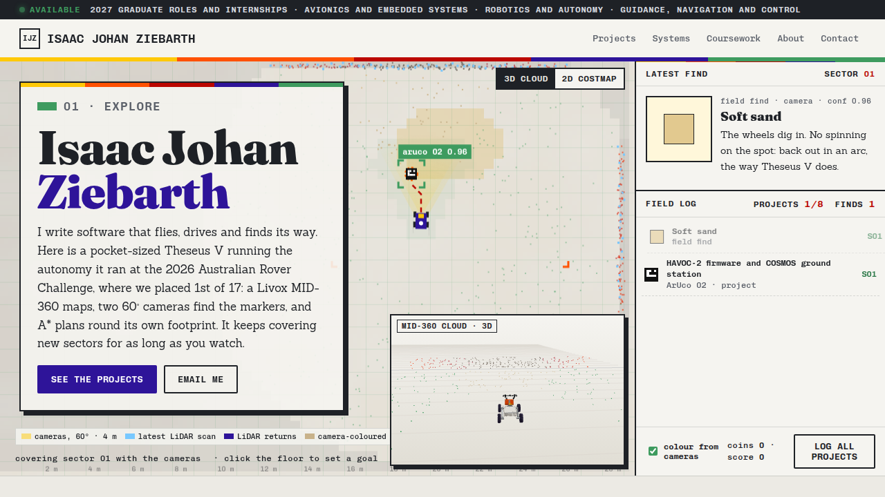](https://zyzzbarth333.github.io)

## Projects

| | Project | |
|---|---|---|
| 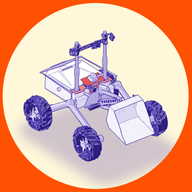 | [Theseus V rover autonomy](https://zyzzbarth333.github.io/projects/theseus.html) | Team project · UQ Space · 2025–26 |
| 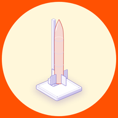 | [HAVOC-2 firmware and COSMOS ground station](https://zyzzbarth333.github.io/projects/havoc2-cosmos.html) | Team project · UQ Space · 2026 |
| 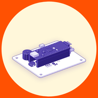 | [OSIRIS flight computer](https://zyzzbarth333.github.io/projects/osiris.html) | Personal project · 2026 |
| 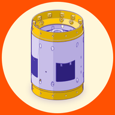 | [Airbrake control simulation](https://zyzzbarth333.github.io/projects/airbrakes.html) | UQ Space · simulation study · 2026 |
| 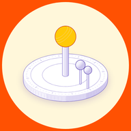 | [Digital orrery and transfer planner](https://zyzzbarth333.github.io/projects/digital-orrery.html) | Personal project · 2025–26 |
| 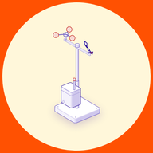 | [Launch-site weather station](https://zyzzbarth333.github.io/projects/weather-station.html) | Team project · UQ Space · 2026 |
| 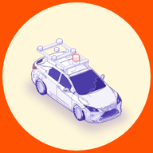 | [Operator tools for Errol, an autonomous research car](https://zyzzbarth333.github.io/projects/errol.html) | UQ Winter Research Program · 2025 |
| 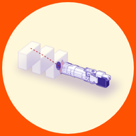 | [A steered cutter pod for a tunnel-boring robot](https://zyzzbarth333.github.io/projects/metr4810.html) | METR4810 · team of 4 · 2026 |
| 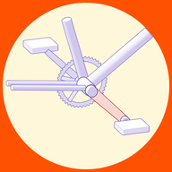 | [Titanium crank arm for metal 3D printing](https://zyzzbarth333.github.io/projects/crank-arm.html) | Individual coursework · UQ · 2026 |
| 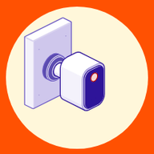 | [Ball joint and mount for a security camera](https://zyzzbarth333.github.io/projects/camera-mount.html) | Personal project · 2022 |
| 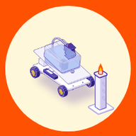 | [Remote-controlled firefighting vehicle](https://zyzzbarth333.github.io/projects/engg1100.html) | First-year team project · 2022 |
|  | [Selected coursework](https://zyzzbarth333.github.io/projects/coursework.html): propulsion, hypersonics, control, robotics, functional safety and computer vision | UQ coursework · 2025 – 2026 |

  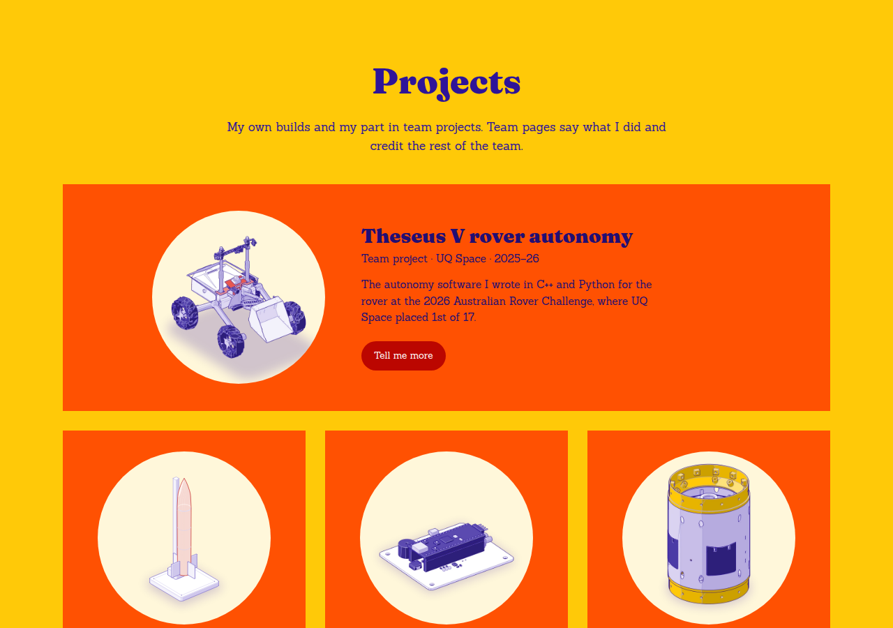
  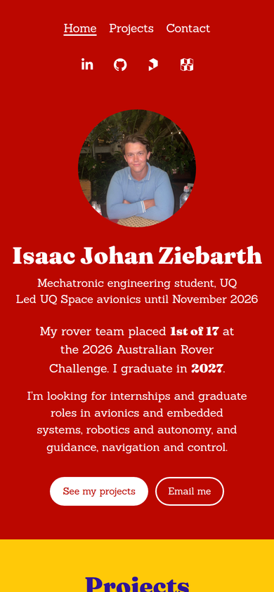

Each project page follows one template: the outcome, a facts box (role, team, dates, tools, code), a lead figure,
then the problem, what was built, the result, what went wrong and credits. Most lead figures are live: flight
logs, a porkchop plot computed in the browser, a LiDAR map, a KiCad board viewer, 3D models and a replay of a
recorded drive of an autonomous car, run in Lichtblick with the car's own Foxglove panels.

  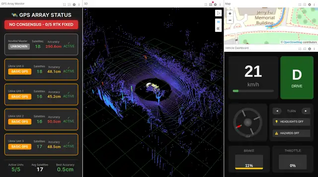
  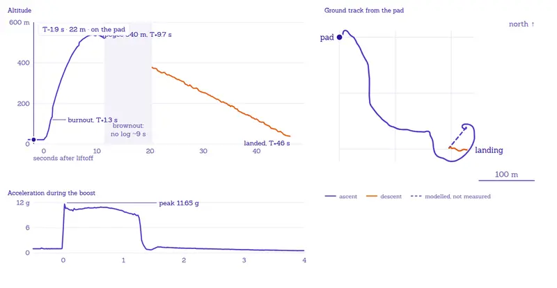

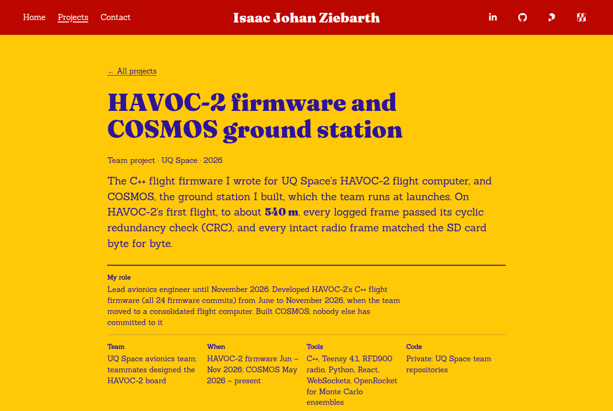

## Structure

| Path | Holds |
|---|---|
| `index.html` | Home: About, project cards, earlier work, Experience, Contact |
| `projects/*.html` | One page per project, all on the same template |
| `404.html` | The page Pages serves for a missing path |
| `sitemap.xml`, `robots.txt` | Search engine basics; every published page has a canonical link |
| `site.webmanifest`, `favicon.ico` | Browser icon and manifest |
| `assets/css/style.css` | All styles. Colours, fonts and spacing are tokens on `:root` |
| `assets/js/site.js` | Scroll fade-ins, embedded-figure sizing and the card icons' motion |
| `assets/figures/` | Interactive figures, each a standalone page embedded in a project page |
| `assets/img/` | Photos, renders and the card icons (`projects/*-icon.svg`) |
| `assets/fonts/` | Self-hosted Fraunces and Sanchez, with their licences |
| `assets/vendor/` | Self-hosted three.js, Astronomy Engine and KiCanvas, with their licences |
| `assets/kicad/` | KiCad files shown by the OSIRIS board viewer |
| `assets/models/` | STL files for the camera mount's 3D viewer |
| `.nojekyll` | Tells Pages to serve the files as they are |
| `.github/readme/` | Screenshots and icons for this README |

## Local preview

Serve the folder so paths resolve as they do on Pages, then open `http://localhost:8000`:

    python3 -m http.server 8000

The Errol replay streams its recording with HTTP range requests, which `python3 -m http.server` doesn't support, so
check that page with a static server that does.

## Publishing

Changes go through a pull request into `main`; [CONTRIBUTING.md](CONTRIBUTING.md) has the workflow and
conventions. Pages publishes `main` (Settings, then Pages: source `main`, root) about a minute after a merge.

## Licence

Copyright (c) Isaac Johan Ziebarth. All rights reserved: the code and content of this site are not licensed
for reuse ([LICENSE](LICENSE)). Third-party parts keep their own licences:

| Part | Licence |
|---|---|
| Anatomy kit, used for `assets/figures/weather-station-exploded.html`, the card icons and `assets/css/iso-kit.css` | MIT (`assets/figures/LICENSE-anatomy-kit.txt`) |
| `assets/figures/osiris-v0-ibom.html`, generated by [InteractiveHtmlBom](https://github.com/openscopeproject/InteractiveHtmlBom) | MIT |
| `assets/vendor/three-0.187.0/`: [three.js](https://github.com/mrdoob/three.js) and five of its addons, minified, for the two 3D figures | MIT (`LICENSE` beside them) |
| `assets/vendor/astronomy-engine-2.1.19/`: [Astronomy Engine](https://github.com/cosinekitty/astronomy), for the orrery page and its porkchop figure | MIT (`LICENSE` beside it) |
| `assets/vendor/kicanvas/`, the KiCad viewer on the OSIRIS page: [KiCanvas](https://kicanvas.org/) ([source](https://github.com/theacodes/kicanvas)). Its font stylesheet points at the self-hosted `fonts/` | MIT (`LICENSE.md` beside it) |
| `assets/vendor/kicanvas/fonts/`: [Material Symbols Outlined](https://github.com/google/material-design-icons), cut down to the icons KiCanvas uses, and [Nunito](https://github.com/googlefonts/nunito) | Apache 2.0 and SIL Open Font License, each with its licence |
| `lichtblick/`: a build of [Lichtblick](https://github.com/lichtblick-suite/lichtblick) v1.31.0 with a small patch (`lichtblick/lichtblick-static-loaders.patch`), for the Errol replay | Mozilla Public License 2.0 (`lichtblick/LICENSE.txt`; source and changes in `lichtblick/SOURCE.md`) |
| `lichtblick/static/errol-vehicle-controls.foxe`: the Errol Vehicle Controls panels, built | MIT, (c) 2025 The University of Queensland (`lichtblick/static/LICENSE-errol-vehicle-controls.txt`) |
| `lichtblick/data/lexus.glb`: simplified from the Lexus model in [Autoware](https://github.com/autowarefoundation/sample_vehicle_launch)'s sample vehicle | Apache 2.0 (`lichtblick/data/LICENSE-autoware.txt`) |
| `lichtblick/data/errol-drive.mcap`: its car-model topic uses the `foxglove.SceneUpdate` schema from [@foxglove/schemas](https://github.com/foxglove/foxglove-sdk) | MIT |
| `assets/fonts/`: [Fraunces](https://github.com/undercasetype/Fraunces) and [Sanchez](https://fonts.google.com/specimen/Sanchez) | SIL Open Font License (texts beside them) |
| Header icons: GitHub and Printables marks from [Simple Icons](https://github.com/simple-icons/simple-icons) | CC0 |
| LinkedIn mark from [Font Awesome Free](https://github.com/FortAwesome/Font-Awesome) | CC BY 4.0 |
| MakerWorld mark, from MakerWorld's site header, used only to link to the author's MakerWorld profile | MakerWorld's trademark |

Fonts and libraries are all served from this repo. There are two outside requests. The visitor count: GoatCounter's
script (`gc.zgo.at/count.js`) sends each page view to `zyzzbarth333.goatcounter.com`, with no cookies and no
personal data stored; embedded figures and local previews are not counted. And the Errol replay's Map panel, once
started, loads its tiles from [OpenStreetMap](https://www.openstreetmap.org/copyright).
